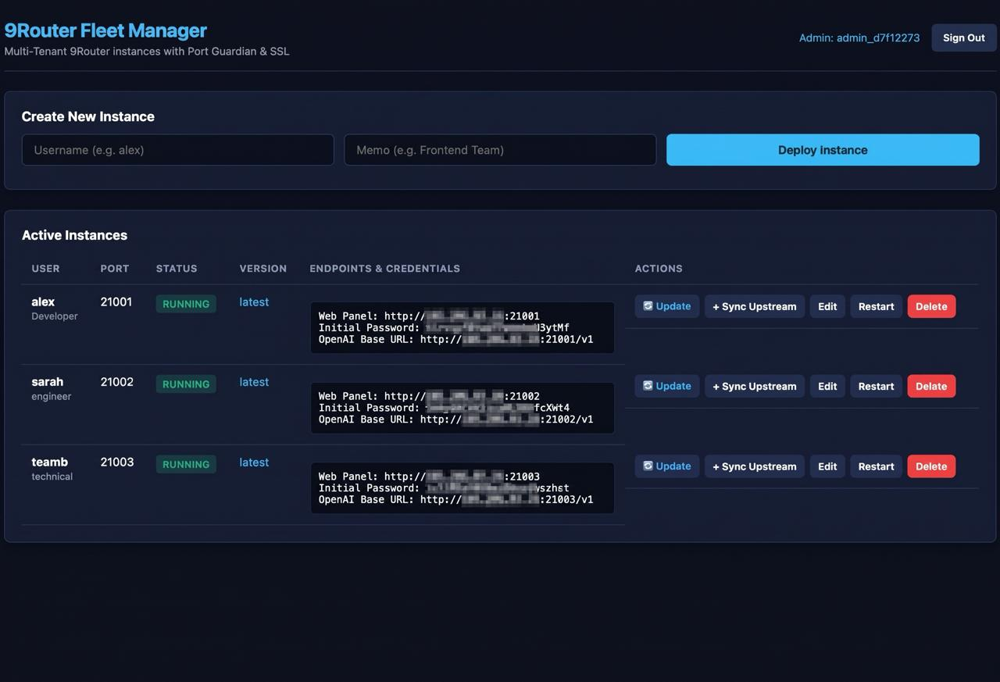

# ⚡ 9Router Fleet Manager

<p align="center">
  <a href="https://github.com/hamedgramzi/9router-fleet-manager/releases"></a>
  <a href="LICENSE"></a>
  
  
</p>

An enterprise-grade, multi-tenant orchestration manager and port guardian for [9Router](https://github.com/decolua/9router) AI proxy instances.

Provides complete database isolation, automated port allocation, SSL termination, upstream proxy injection (e.g. Warp), and **zero-downtime rolling updates with automatic fail-safe rollbacks**.

<p align="center">
  
</p>

---

## ✨ Features

- **Multi-Tenant Isolation**: Each user/tenant gets their own isolated Docker container, storage directory, and SQLite database.
- **Port Guardian Architecture**: An Nginx reverse-proxy front-end terminates SSL/TLS and routes requests seamlessly to user containers.
- **Fail-Safe Rolling Updates**:
  - One-click container updates directly from the admin UI.
  - Pre-pulls target images before touching running containers.
  - Atomic online SQLite database backup (`.pre_update_bak`).
  - Preserves user sessions and API keys by retaining `JWT_SECRET`.
  - Multi-stage health checks against `/login`.
  - **Automatic Rollback**: Restores original container and database state if migrations fail or the new container fails health checks.
  - Cleans up backup files and temporary containers automatically on success.
- **Upstream Proxy Injection**: Background injection of outbound proxy pools (e.g., Cloudflare Warp / SOCKS / HTTP) directly into the tenant's SQLite database upon boot.
- **Resource Governance**: Enforces memory limits (e.g. 256MB) and CPU quotas (e.g. 0.35 cores) per tenant.
- **Lightweight & Native UI**: Modern dark-mode dashboard with instant credentials viewing, editing, restarting, and updating.

---

## 🏗️ Architecture

```
Internet (HTTPS)
   │
   ▼
[ 9Router Port Guardian (Nginx) ] ── (Ports: 21001-21050 with Let's Encrypt SSL)
   │
   ├── Port 21001 ──► [ Container: 9router-alex  ] ──► SQLite (alex/data/db)
   ├── Port 21002 ──► [ Container: 9router-sarah ] ──► SQLite (sarah/data/db)
   └── Port 21003 ──► [ Container: 9router-teamB ] ──► SQLite (teamB/data/db)
                             │
                             ▼ (Egress through injected Upstream Proxy / Warp)
                      [ 172.18.0.1:40001 ]
```

---

## 🚀 One-Line Installation

You can install and deploy **9Router Fleet Manager** with a single command on any clean Linux server (Ubuntu/Debian/CentOS/Rocky):

```bash
bash <(curl -Ls https://raw.githubusercontent.com/hamedgramzi/9router-fleet-manager/main/install.sh)
```

The installer will automatically:
1. Verify and install dependencies (Docker, Python 3, venv, Curl, SQLite).
2. Configure an isolated Python virtual environment.
3. Launch the Nginx **Port Guardian** front-end.
4. Register and enable the systemd service (`9router-fleet.service`).
5. Install the convenient **`9router-fleet`** CLI management tool in `/usr/local/bin`.
6. Print your ready-to-use Web Panel URL and auto-generated admin credentials.

---

## 💻 Management CLI (`9router-fleet`)

After installation, simply run `9router-fleet` (or `9router`) in your terminal for an interactive management menu:

```bash
9router-fleet
```

```text
  ⚡ 9Router Fleet Manager Management CLI
  ---------------------------------------
  1. Start Service
  2. Stop Service
  3. Restart Service
  4. Check Status
  5. View Logs
  ---------------------------------------
  6. Show Web Panel URL & Credentials
  7. Update Fleet Manager
  8. Uninstall Fleet Manager
  ---------------------------------------
  0. Exit
```

You can also pass arguments directly:

```bash
9router-fleet status        # Check fleet service and guardian status
9router-fleet restart       # Restart fleet panel and guardian
9router-fleet creds         # Show Web Panel URL and admin credentials
9router-fleet logs          # Follow real-time application logs
9router-fleet update        # Pull latest updates and restart
9router-fleet uninstall     # Cleanly uninstall services and containers
```

---

## 🛠️ Manual Installation & Docker Compose

---

## 🔒 Security & Admin Access

When the panel starts for the first time, it automatically generates a random admin credential file in `panel/data/admin.json`.

To retrieve your admin credentials:

```bash
cat panel/data/admin.json
```

Navigate to `http://your-server-ip:21000` to log in.

---

## 🔄 How the Auto-Rollback Update Works

When you click **🔄 Update** on an active instance:

1. **Pre-Flight Pull**: Downloads the target image (`decolua/9router:latest`). If pulling fails, the active container is left untouched.
2. **Atomic Backup**: Performs an online, non-blocking snapshot of SQLite `data.sqlite`.
3. **Session Preservation**: Extracts and carries over the existing `JWT_SECRET` and configuration environment variables.
4. **Warm Fallback**: Pauses the current container and renames it to `{container}-old` rather than destroying it.
5. **Boot & Verify**: Spawns the new container and polls the TLS endpoint for HTTP 200 over a 40-second window.
6. **Result**:
   - **If Healthy**: Destroys the temporary old container, purges the backup database file to conserve disk space, and records the new package version.
   - **If Unhealthy / Crash**: Immediately kills the broken container, restores the original database file (clearing any partial WAL locks), and relaunches the old container seamlessly.

---

## 🌐 Outbound Proxy Pool Injection (Warp / SOCKS / HTTP)

Major AI model providers (such as OpenAI and Anthropic) often block or heavily rate-limit IP ranges originating from data centers and restricted regions.

To guarantee uninterrupted outbound AI connectivity for your users, **9Router Fleet Manager** provides native, automated proxy pool injection:

### How It Works:
1. **Automated Database Injection**: Upon deploying a new tenant container, Fleet Manager waits for the SQLite database (`data.sqlite`) to initialize and injects an active proxy pool entry into the tenant's `proxyPools` table in the background.
2. **One-Click Manual Fallback (`+ Add Proxy Pool`)**: If container initialization takes longer than expected or if you want to re-sync proxy settings on demand, click **`+ Add Proxy Pool`** next to any tenant in the admin dashboard. This injects the proxy pool directly into the tenant's database and restarts the container.

### Configuration (`.env`):

Configure your upstream egress proxy in `.env`:

```env
# Enable or disable outbound proxy injection (true/false)
ENABLE_UPSTREAM_PROXY=true

# Display label inside 9Router tenant dashboard
UPSTREAM_PROXY_NAME=Warp

# Outbound Proxy URL (HTTP or SOCKS5)
UPSTREAM_PROXY_URL=http://172.18.0.1:40001

# Proxy type: http or socks5
UPSTREAM_PROXY_TYPE=http

# Strict proxy routing (true/false)
UPSTREAM_PROXY_STRICT=false
```

*Note: If your server has direct, unblocked access to AI APIs, you can disable this feature by setting `ENABLE_UPSTREAM_PROXY=false`. The `+ Add Proxy Pool` button will automatically hide in the dashboard.*

---

## ⚙️ Configuration Reference

| Environment Variable | Default | Description |
|---|---|---|
| `DOMAIN_NAME` | `(empty)` | Public domain resolving to this host for TLS (leave empty for IP / HTTP mode) |
| `SERVER_IP` | `(auto)` | Public server IP, auto-detected during installation |
| `PANEL_PORT` | `21000` | Port for the Fleet Manager web interface |
| `PORT_RANGE_START` | `21001` | First allocated port for tenant instances |
| `PORT_RANGE_END` | `21050` | Last allocated port for tenant instances |
| `ROUTER_IMAGE` | `decolua/9router:latest` | Docker image tag for 9Router containers |
| `CONTAINER_MEM_LIMIT` | `256m` | Hard memory ceiling per tenant |
| `CONTAINER_CPUS` | `0.35` | CPU quota allocation per tenant |
| `ENABLE_UPSTREAM_PROXY` | `true` | Auto-inject outbound proxy pool into SQLite |
| `UPSTREAM_PROXY_NAME` | `Warp` | Name label for injected proxy pool |
| `UPSTREAM_PROXY_URL` | `http://172.18.0.1:40001` | Upstream proxy URL (HTTP/SOCKS5) |
| `UPSTREAM_PROXY_TYPE` | `http` | Upstream proxy type (`http` or `socks5`) |
| `UPSTREAM_PROXY_STRICT` | `false` | Enforce strict proxy routing |
| `SSL_CERT_PATH` | `/etc/letsencrypt/...` | Fullchain certificate path |
| `SSL_KEY_PATH` | `/etc/letsencrypt/...` | Private key certificate path |

---

## 📄 License

MIT License. Contributions and PRs are welcome!
